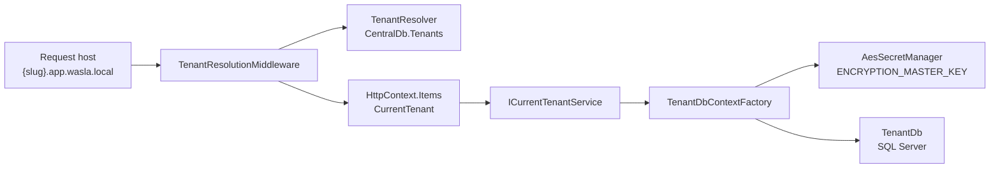

# Tenancy

## Purpose and scope

This document describes how Wasla isolates restaurant SaaS accounts (tenants) across CentralDb, per-tenant databases, host resolution, and connection-string handling.

It owns:

- Central registry vs tenant operational data
- Host/domain resolution and `CurrentTenant`
- `TenantDbContextFactory` and encrypted connection strings
- Provisioning / deletion / reset boundaries

It does not own authentication cookies/schemes (see [authentication.md](authentication.md)) or UI role matrices (see [roles-and-permissions.md](../product/roles-and-permissions.md)). Terminology lives in [terminology.md](../product/terminology.md).

## Current model

A tenant represents one independently operated restaurant location in the current architecture. That location has its own tenant database, orders, Live Screen, platform connections, provider store identifiers, Print Bridge setup, operational settings, and users.

Wasla uses **CentralDb + one physical database per tenant**. It does **not** use shared-schema multi-tenancy. Businesses operating multiple restaurant locations currently use separate tenants for those locations. Tenant remains the data-isolation boundary and the operational boundary. A grouping above tenants is not implemented; see [Future multi-location direction](#future-multi-location-direction).

### Agent warnings

Future agents must **not**:

- Recreate `CustomerDbContext`, `CurrentCustomer`, or similar renamed-away types for new work
- Provision, create, migrate, or drop tenant databases from request middleware or tenant resolution
- Treat CentralDb as a shared operational store for orders
- Document shared-schema multi-tenancy as the Wasla model
- Model extra restaurant locations as extra `StoreId`s or extra same-platform connections inside one tenant
- Add `BranchId` to orders, platform connections, print jobs, settings, or Live Screen to represent those locations

## CentralDb

**Source:** `src/Wasla.Infrastructure/Persistence/Central/CentralDbContext.cs`

CentralDb is the central registry. Connection is a static config connection string (`ConnectionStrings:CentralDb`), not per-request decrypted.

Main `DbSet` entities:

| Entity | Role |
|--------|------|
| `Tenant` | One restaurant location: registry row, database, and operational boundary |
| `TenantMembership` | Central membership links |
| `CentralAdminUser` | Central admin operators |
| `PendingRegistration` | Signup / payment / provisioning pipeline |
| `BillingPlanPrice` / `BillingSubscription` / `BillingPayment` | Wasla plan prices, subscription identity and state, verified paid periods (WAS-147; see [billing.md](billing.md)) |
| `PrintBridgeDevice` / `PrintBridgeSetupSession` | Print Bridge device registry (central) |
| Address/catalog helpers | `BusinessType`, `Country`, `City`, `District`, `Neighborhood`, `Street`, and related pending-registration join |

### Tenant registry entity

**Source:** `src/Wasla.Domain/Entities/Central/Tenant.cs`

Current implementation stores, among other fields:

- `Name`, `Slug`, `PrimaryDomain`
- `DatabaseName`
- `EncryptedConnectionString` (AES-256-GCM Base64; never log)
- `EncryptionKeyVersion`
- `SchemaVersion`, migration metadata
- `IsActive`
- Billing / provisioning / subscription status enums (written at provisioning, not the billing source of truth; see [billing.md](billing.md#what-is-reused-and-what-is-not))

Resolution looks up by `PrimaryDomain` (case-normalized) and requires `IsActive`.

## Database-per-tenant

**Source:** `src/Wasla.Infrastructure/Persistence/Tenant/TenantDbContext.cs`

Each active tenant has a dedicated SQL Server database holding operational data (orders, users, platform connections, print jobs, settings, etc.).

`TenantDbContext` is created through `ITenantDbContextFactory` / `TenantDbContextFactory`, not via a single shared connection for all tenants.

Domain types for tenant-DB entities still live under the legacy namespace `Wasla.Domain.Entities.Customer` (for example `Order`, `PlatformConnection`). That namespace is historical; it does **not** mean CentralDb `Customer` still exists. The central SaaS entity is `Tenant`.

## Host / domain resolution

### Host contract (WAS-66)

Wasla Orders answers on three kinds of host. Two settings in `Wasla:TenantOnboarding` define them; nothing else (no request value, no forwarded header) does.

| Host | Production | Development | Role |
|------|------------|-------------|------|
| Marketing | `wasla.tr` (`MarketingBaseDomain`), plus `www.wasla.tr` | `wasla.local`, `www.wasla.local`, and in Development only `localhost` and IP addresses | Public marketing site (homepage, `/pos`), signup, checkout. `/auth` asks for the tenant address |
| Application | `app.wasla.tr` (`ApplicationBaseDomain`) | `app.wasla.local` | Central entry into Wasla Orders. Neither a tenant nor the marketing site (see the [host and path policy](#host-and-path-policy)) |
| Tenant | `{slug}.app.wasla.tr` | `{slug}.app.wasla.local` | One tenant, resolved by its stored `PrimaryDomain` |

Classification is `WaslaHostClassifier` (`src/Wasla.Application/Onboarding/WaslaHostClassifier.cs`). It compares exact host boundaries only:

- The host is trimmed and lower-cased, and one trailing dot is removed; the port is never part of it. `SUSHIM.App.Wasla.TR.` and `sushim.app.wasla.tr:8443` are the same tenant host, with one cache key.
- A tenant host is exactly one label followed by `.{ApplicationBaseDomain}`. The label must be a valid slug (`^[a-z0-9][a-z0-9_-]*$`, at most 63 characters) and not a reserved name.
- `localhost` and IP addresses (IPv4 and IPv6) are Development-only: in Development they act as the marketing host so a local run works without host names; in every other environment (Production, Staging, Pilot, …) they are invalid hosts. The caller decides with `allowLocalHosts`, which Web and Api set from `IHostEnvironment.IsDevelopment()`.
- Everything else is invalid: an empty or additional label (`a.b.app.wasla.tr`), an invalid slug, a reserved label (`admin.app.wasla.tr`), a look-alike suffix (`sushim.app.wasla.tr.evil.example`, `app.wasla.tr.evil.example`, `evilapp.wasla.tr`), the former `{slug}.wasla.tr` shape, and any other host name.
- An invalid host serves only the any-host paths below. Everything else gets the same response as an unregistered tenant address (a redirect to `/tenant-not-found?host=…`, then 404; the Print Bridge API a plain 404) without any CentralDb lookup, so the two cannot be told apart and a flood of invented hosts costs nothing.
- Never a fallback: no host resolves to another tenant, the first tenant or a default tenant.

**Reserved names.** `RegistrationNameNormalizer.ReservedSlugs` is the one list: `admin`, `api`, `app`, `docs`, `help`, `partners`, `pos`, `status`, `www`. Signup refuses them as unavailable addresses (`Signup.SlugUnavailable`), slug availability reports them as taken, and resolution never looks them up. Root-level names such as `admin.wasla.tr` or `api.wasla.tr` are not tenant hosts at all; they stay free for Wasla's own products and infrastructure.

**Former shape.** Tenant hosts used to be `{slug}.{MarketingBaseDomain}`. The production domain was not live under that shape, so there is no redirect from it: `{slug}.wasla.tr` is an invalid host. Development tenants created before WAS-66 keep `{slug}.wasla.local` in `Tenants.PrimaryDomain` and are not reachable until that value is changed to `{slug}.app.wasla.local` (or the tenant is provisioned again).

**Startup validation.** Web and Api refuse to start when either domain is not a host name with at least two labels (no scheme, port or path), when the two are equal or the application domain is the `www.` host, or when the marketing domain is under the application domain (`TenantOnboardingOptionsValidator`, every environment). Outside Development they also refuse to start when either key is not set or names a Development-only domain: `localhost`, or a name under `.localhost`, `.local`, `.test`, `.example`, `.invalid`, `.internal`, `.lan` or `.home.arpa` (`AddWaslaHostDomains` in both `Program.cs` files, `src/Wasla.Infrastructure/DependencyInjection/HostDomainRegistration.cs`). The committed base `appsettings.json` names no domain; only `appsettings.Development.json` sets `wasla.local` and `app.wasla.local`, which are also the code defaults. Wasla.Worker and the CLI build no links and are not checked.

**Generated URLs.** Tenant links (status pages, panel sign-in, welcome and password-reset links, provisioning email, Central Admin) are built from the tenant's stored `PrimaryDomain` (`TenantWelcomeUrlBuilder`). Marketing links (homepage, signup, canonical URL) and the application sign-in use the configured domains. The request contributes only its scheme and, in Development and Staging, its port. Only in Development does a request on `localhost` keep `localhost` for the marketing and application links (and a request on `localhost` or an IP address keep that host in the canonical URL), so a local run works without host names; elsewhere a direct or hostile `localhost`/IP request never decides a generated host.

### Host and path policy

`TenantResolutionMiddleware` classifies the host first and then the path; no path makes a host serve what its role does not. Prefixes match whole path segments (`/signupx` is not `/signup`).

| Path | Marketing | Application | Tenant | Invalid |
|------|-----------|-------------|--------|---------|
| Static assets (`/css`, `/js`, `/lib`, `/images`, `/img`, `/favicon*`), `/error`, `/health/*`, `/culture`, `/setlanguage`, `/tenant-not-found` | Served | Served | Served | Served |
| Marketing pages (`/`, `/pos`) and every other page | Served | → `/tenant-address-required` | Tenant resolved, then served | → tenant-not-found |
| `/auth/*` | → `/tenant-address-required` | → `/tenant-address-required` | Tenant resolved, then served | → tenant-not-found |
| `/signup*`, `/checkout*` | Served | → same path on the marketing host | → same path on the marketing host | → tenant-not-found |
| `/signup/pending/{id}` | Served | → same path on the marketing host | Served (the status page a pending tenant host redirects to) | → tenant-not-found |
| `/tenant-address-required` | Served | Served | Tenant resolved, then served | → tenant-not-found |
| `/admin/*` (Central Admin) | Served | Served | Served | → tenant-not-found |
| `/api/print-bridge/*` | Served | Served | Served | 404 |

- "Served" without a tenant means no tenant resolution and no `CurrentTenant`. Tenant pages on the marketing or application host get no tenant and fail their authorization as before.
- The redirect to the marketing host is built from `MarketingBaseDomain`, keeps the path and query, and keeps the request port only in Development and Staging.
- **Health probes** answer on every host, an empty `Host` included, because a probe may address the process by IP, `localhost` or a container name; they carry no tenant data. This is the only reason a `localhost` or IP request gets an answer outside Development: every other path treats it as an invalid host.
- **Central Admin** stays under `/admin` on the marketing, application and tenant hosts, as before WAS-66, with its own host-only cookie; it is not served on invalid hosts. There is no `admin.wasla.tr` routing.
- **Print Bridge** devices are authenticated by `X-PrintBridge-Token`, not by the host, so the API answers on every valid Wasla host (the setup page hands out the tenant host, or `Wasla:TenantWebBaseUrl` / `Wasla:PublicWebBaseUrl` behind a proxy). Invalid hosts get a plain 404.
- A request without a `Host` header gets 400, except on the any-host paths.

DNS, wildcard DNS, the reverse proxy, the `www.wasla.tr` redirect and TLS certificates are deployment work (WAS-76); see [../operations/deployment.md](../operations/deployment.md#domains-and-https).

### Resolver

**Source:** `src/Wasla.Infrastructure/Tenant/TenantResolver.cs`

- Input: request host
- Lookup: `CentralDb.Tenants` where `PrimaryDomain` matches (lowercased) and `IsActive`
- Result: `ResolvedTenantDto` (Id, Name, Slug, PrimaryDomain)
- In-resolver cache TTL: **5 minutes** (`tenant:{host}`)

### Web middleware

**Source:** `src/Wasla.Web/Middleware/TenantResolutionMiddleware.cs`

- Cache TTL: **5 minutes** (`tenant:{host}`)
- Sets `HttpContext.Items["CurrentTenant"]` to `ResolvedTenantDto`
- Bypass prefixes include `/admin`, `/signup`, `/checkout`, static assets, `/api/print-bridge`, health/swagger, and several public status/access pages
- Classifies the `Host` header with the [host contract](#host-contract-was-66); `X-Forwarded-Host` is never applied
- Marketing hosts (the marketing domain, `www.{domain}`, and in Development `localhost` and raw IPs) skip tenant resolution for normal public routes; `/auth` on a marketing host redirects to tenant-address guidance
- The application host redirects every non-bypass path to `/tenant-address-required`
- Tenant hosts are `{slug}.{ApplicationBaseDomain}`, looked up by the normalized host. If no tenant exists: checks pending registration, else redirects to tenant-not-found. That outcome is kept in the [unknown-host cache](#unknown-host-cache)
- Invalid hosts redirect to tenant-not-found without any lookup
- Does **not** create databases, run migrations, or provision tenants

### API middleware

**Source:** `src/Wasla.Api/Middleware/TenantResolutionMiddleware.cs`

- Same `Items["CurrentTenant"]` key and **5-minute** host cache
- Same host contract as Web (WAS-66): the host is classified with `WaslaHostClassifier` (local hosts only in Development) before any lookup, and only exactly `{slug}.{ApplicationBaseDomain}` is looked up, by its normalized host
- `/health/*` and `/swagger` (mapped only in Development) answer on any host; `/api/print-bridge/*` (device-token authentication) answers on the marketing, `www`, application and tenant hosts and is a plain 404 on invalid hosts. Prefixes match whole path segments
- Every other path on a host that is not a tenant host (marketing, `www`, the application entry, the former `{slug}.wasla.tr`, reserved, extra-label, look-alike and arbitrary hosts, and `localhost`/IPs outside Development) → HTTP 404 `"Tenant not found"` without a CentralDb lookup, even when CentralDb holds a tenant whose stored domain is exactly that host
- Unknown tenant address → the same 404 (no pending-registration UX redirects), kept in the [unknown-host cache](#unknown-host-cache)
- Does **not** provision databases

### Unknown-host cache

**Source:** `src/Wasla.Infrastructure/Tenant/TenantHostMissCache.cs` (WAS-90), used by both middlewares.

The `Host` header is chosen by the client, so without this every request with an invented tenant-looking host was at least one CentralDb query (Web: two, tenant and pending registration).

- A host that resolves to no tenant is remembered with what was found (nothing, or a pending registration for the Web redirect) for **60 seconds** (`TenantResolution:MissCache:Ttl`). Repeated requests for it within that time do not query CentralDb.
- Requests for the same host that arrive while its lookup runs wait for that one lookup. The lookup is not cancelled when the request that started it ends. A lookup that fails (CentralDb down) is not remembered.
- The cache holds at most **10,000** hosts (`TenantResolution:MissCache:MaxEntries`). When it is full, a further miss is answered correctly but not remembered until entries expire, so random hosts cannot grow memory beyond the bound.
- The key is the host exactly as `TenantResolver` looks it up: in Web the normalized tenant host of the [host contract](#host-contract-was-66) (trimmed, lower-cased, one trailing dot removed, no port); in Api the trimmed, lower-cased `Request.Host.Host`. An entry can only answer for the host that produced it, and a miss is never served for a tenant's own host. Web looks up only valid tenant hosts, so invalid hosts never reach this cache there. `X-Forwarded-Host` is never applied. Tenants are not stored here; they stay in the 5-minute tenant cache.
- **Trade-off:** a tenant created (or reactivated) for a host that was just requested shows as unknown for at most the TTL, and a pending registration's redirect can be up to the TTL old. Both settle on their own; there is no manual invalidation.
- Validated at startup: `Ttl` from `00:00:01` to `00:10:00`, `MaxEntries` from 1 to 1,000,000. Process-local, like the other caches below.

### CurrentTenant

**Sources:**

- `src/Wasla.Web/Tenant/CurrentTenantService.cs`
- `src/Wasla.Api/Tenant/CurrentTenantService.cs`

Both read `HttpContext.Items["CurrentTenant"]` only. They do not query CentralDb themselves.

Authorization handlers that need tenant scope compare the authenticated `TenantId` claim to this resolved tenant (see authentication / roles docs).

## TenantDbContextFactory and secrets

**Source:** `src/Wasla.Infrastructure/Persistence/Tenant/TenantDbContextFactory.cs`

Current implementation:

1. Loads the `Tenant` row from CentralDb by id
2. Decrypts `EncryptedConnectionString` via `ISecretManager`
3. Builds SQL Server `DbContextOptions` and returns a new `TenantDbContext`
4. Caches options builders per tenant id in-process

**Encryption:** `src/Wasla.Infrastructure/Security/AesSecretManager.cs`

- Master key environment variable name: `ENCRYPTION_MASTER_KEY` (Base64, 32 bytes when decoded)
- Web and API call `AesSecretManager.ValidateMasterKeyOrThrow()` at startup
- Do not log plaintext connection strings, decrypted secrets, or the master key

## Provisioning, deletion, and reset boundaries

### Allowed provisioning paths

Provisioning creates the tenant database and CentralDb registry state. Current shared orchestration:

- `src/Wasla.Infrastructure/Services/PendingRegistrationProvisioningService.cs`
- Invoked by:
  - CLI: `provision-signup-request` (`src/Wasla.Cli/CliCommandTree.cs`)
  - Central Admin UI: `PendingRegistrationsController.Provision` (`src/Wasla.Web/Areas/Admin/Controllers/PendingRegistrationsController.cs`)
- Related CLI onboarding: `add-tenant` (creates registry + DB + first admin)

### Tenant database identity (WAS-93)

Provisioning fails closed on databases it cannot prove it created for the tenant being provisioned.

- **Server-assigned names.** Signup and `add-tenant` assign `Wasla_{Label}_{12 hex}`, where the label is the slug in PascalCase (`Tenant` when empty, a `T` prefix when it starts with a digit) and the suffix is random (`TenantDatabaseNames`). The business name no longer forms the name, so a business called "Central" gets `Wasla_Central_3f9a…`, not the CentralDb catalog `Wasla_Central`. A new name is free when no tenant and no registration in any status uses it.
- **Reserved names.** Before any database work, provisioning and `add-tenant` refuse the CentralDb catalog (compared case-insensitively) and the SQL Server system databases (`master`, `model`, `msdb`, `tempdb`, `mssqlsystemresource`, `distribution`, `SSISDB`, `ReportServer`, `ReportServerTempDB`). An unknown CentralDb catalog is a refusal.
- **Ownership marker.** Right after `CREATE DATABASE`, provisioning stores the database-level extended property `Wasla.TenantDatabaseOwner` = `PendingRegistration:{registrationId}` (signup) or `Tenant:{tenantId}` (`add-tenant`). If the name already exists on the server, the database is reused only when that property names the same registration; a missing or different marker stops provisioning with "will not adopt it", and CentralDb is not written. `--force` does not bypass this. Source: `src/Wasla.Infrastructure/Services/TenantDatabaseOwnership.cs`.
- **Unique `Tenants.DatabaseName`.** Index `IX_Tenants_DatabaseName` (migration `AddTenantDatabaseNameUniqueIndex`). The migration stops with error 50093 and changes nothing if existing rows already share a name; an operator resolves those rows first (the query is in the error). It is not applied automatically.
- **Atomic CentralDb writes.** The tenant row, its membership and the registration's `Provisioned` status are committed in one transaction (`add-tenant`: tenant and membership). A failure leaves the registration `PaymentSucceeded` without a tenant row.
- **Partial failures.** A database created by a failed attempt is not dropped automatically (a timeout after a successful commit must never drop a live tenant). It keeps its marker, so only a retry of the same registration resumes it, and no other tenant can inherit it. If the process stops between `CREATE DATABASE` and writing the marker, the next attempt finds an unmarked database and refuses it; an operator checks that it is empty and removes it.
- **Existing tenants.** Databases created before WAS-93 have no marker and keep their old names. Nothing reads the marker for them in normal operation, migrations or the CLI; only provisioning them again (for example `--force` on a registration marked Provisioned without a tenant row) is refused.
- **Operator review.** Central Admin's pending-registration details show the registration's target `DatabaseName`.
- **Explicit SQL Server.** Tenant databases are created on `--sql-server`, else `TenantDb:ServerInstance` (`TenantSqlServerConfiguration`, WAS-136); no other key is read. Unset, empty or whitespace-only values do not count; with neither, provisioning and `add-tenant` stop before any database work. There is no fallback to LocalDB or `.`; Development configures LocalDB explicitly. A value that is set but malformed (for example containing `;`) stops provisioning instead of falling through to the configured server.
- **One attempt per registration.** Provisioning takes a session-owned SQL Server application lock in CentralDb (`sp_getapplock`, resource `Wasla.ProvisionRegistration.{registrationId}`) before reading the registration, and holds it until it returns (`ProvisioningRegistrationLock`). A simultaneous attempt from any Web or CLI process is refused at once ("in progress") before any database work; a later one reports AlreadyProvisioned. Without it, a second attempt could find the first attempt's marker, resume, and run EF migrations against the same tenant database at the same time. The lock ends with the session, so a crashed process does not leave it held. SQLite unit tests run without it; it was verified against LocalDB.

### Destructive CLI ops (high level)

| Command | Intent |
|---------|--------|
| `delete-tenant` | Delete central tenant record and drop tenant DB (destructive; requires confirm) |
| `reset-tenant-db` | Drop/recreate/migrate one tenant DB; keep CentralDb tenant row (destructive) |
| `migrate-tenant` | Apply pending tenant DB migrations for one tenant |

Full inventory and guards: [../operations/cli.md](../operations/cli.md).

### What resolution must not do

Tenant resolution (Web or API middleware / `TenantResolver`) must **not**:

- Create or delete SQL databases
- Run EF migrations
- Mark pending registrations as provisioned
- Write encrypted connection strings
- Treat payment success as automatic DB creation

Payment success and provisioning remain separate states (see product signup docs / AGENTS rules). Middleware may redirect to pending-signup UX; it must not perform provisioning.

### Signup and checkout access

A registration ID is not secret: the pending-tenant redirect and `/tenant-not-found?host=` reveal it. So the ID alone grants nothing.

- A successful signup submission is the only place that issues ownership proof: a Data Protection payload bound to that one registration ID, with the registration's expiry, in the HttpOnly, SameSite=Strict, host-only cookie `.Wasla.SignupRegistration` (Secure outside Development). It is never put in a URL. Proofs survive restarts and work across instances only when they share the key ring (`DataProtection:KeyPath`, application name `Wasla`).
- `/signup/pending/{id}` shows the status and tenant address to anyone, and the applicant's details and checkout link only to the proven browser. `/checkout/review` and `/checkout/success` redirect anyone else to that status page. `/checkout/failed` and `/checkout/cancelled` are generic. The pending, review, and success pages are sent with `Cache-Control: no-store`.
- `POST /checkout/cancel/{id}` requires the proof; without it the request gets 404 and nothing changes.
- The payment simulator (`POST /checkout/simulate-success|simulate-failed/{id}`, its buttons, and the "payment will be simulated" note) exists only in Development, and only for the proven browser. Elsewhere the endpoints return 404. There is no real payment integration yet; the provider-neutral billing model it will use is in [billing.md](billing.md), and the simulator writes none of it.
- Signup and checkout copy follows the same check (`CheckoutPaymentSimulator`, the host environment, never a request value; WAS-39). In Development the signup form, pending page, payment summary and failed page explain the simulator. Elsewhere they say that payment is not taken on these pages, that the registration awaits payment, and that the panel is prepared after payment is received; no page names a payment provider. There the signup form's submit button reads "Submit registration", `/checkout/review` is titled "Registration summary", and the buttons that lead to it (pending, failed and rate-limited pages) read "View registration summary" / "Return to registration summary". Status text such as "Payment pending" stays; nothing offers to start, continue or return to an online payment.
- Public signup can be closed with `Wasla:TenantOnboarding:PublicSignupEnabled` (default `true`; WAS-76, `PublicSignupRequiredAttribute`). When it is `false`, `GET /signup` shows a page saying that online registration is not open yet, with the Instagram contact link and no form; `POST /signup` passes the antiforgery check as before and then, ahead of model binding and the rate limit, returns that page with 404 and creates and hashes nothing; the form's address lookups (`/signup/districts`, `/neighborhoods`, `/streets`) return 404. `/signup/pending/{id}` and the checkout pages keep working for existing registrations. Production sets it to `false` until a payment provider can complete a signup.
- Every POST validates the antiforgery token. Status changes are compare-and-set on the status that request read, so a concurrent payment, failure, or cancellation is never overwritten (`PendingRegistrationService`).

### Signup abuse limits

Added in WAS-90. Every anonymous request that creates or changes a pending registration is bounded:

| Bound | Default | Where | Over the bound |
|-------|---------|-------|----------------|
| `POST /signup` per client network | 10 per hour (`AuthenticationRateLimiting:SignupSubmission`) | Web rate-limit filter, after antiforgery and before the action | `429` with `Retry-After`: the signup form again (option lists, entered values, never the password) with `Signup.TooManyAttempts` in the validation summary |
| Checkout POSTs that change a registration (`/checkout/cancel`, the Development simulator) per client network | 20 per 10 minutes (`AuthenticationRateLimiting:SignupCheckout`) | Same filter | `429` with `Retry-After`: a short page with `Checkout.TooManyAttempts` and a link back to the payment step; the registration is not read or changed |
| Active registrations (Draft, AwaitingPayment, PaymentSucceeded, not expired) per owner email | 3 (`Wasla:TenantOnboarding:MaxActivePendingRegistrationsPerOwnerEmail`) | `PendingRegistrationService.SubmitAsync`, before any other lookup, the password hash or the insert; email compared trimmed and case-insensitively | `429` with the same form and message as the network limit, so the response does not say which bound applied |
| Database-name assignment | 2 queries, at most 6 | `PendingRegistrationService`: a random server-assigned name (see [Tenant database identity](#tenant-database-identity-was-93)), one query per table per attempt, up to 3 attempts | `DuplicateDatabaseName` only if all 3 random names are taken |

A paid (`PaymentSucceeded`) registration keeps its slug, domain and database name, counts toward the per-email cap, and still shows the "panel being prepared" status page after its original expiry, until it is provisioned or otherwise resolved (WAS-93). Unpaid registrations still stop reserving at expiry.

A rejected attempt creates no registration and does no hashing. The network limits are the shared credential rate limiter ([authentication.md](authentication.md#credential-rate-limiting)), with the same partitions, logging and process-local counters. The per-email cap is read from CentralDb, so it holds across processes and restarts. It is a count followed by an insert, not a lock: signups for one email submitted at the same moment can each pass the count, so the cap can be exceeded by the number of simultaneous requests, which the network limit in turn bounds. The database-name search used to probe numbered names one at a time, about two queries per taken name and up to roughly 20,000 for a popular name.

**Sources:** `src/Wasla.Web/Security/SignupRegistrationOwnership.cs`, `src/Wasla.Web/Controllers/SignupController.cs`, `src/Wasla.Web/Controllers/CheckoutController.cs`, `src/Wasla.Infrastructure/Services/PendingRegistrationService.cs`, tests in `tests/Wasla.UnitTests/Signup/`.

## Platform connections (tenant DB)

Each tenant may have at most one `PlatformConnection` per platform. A second Trendyol GO connection for the same tenant is rejected even when the second row would use a different `StoreId`. Deactivating a connection does not allow another row for that platform; removing it (which deletes the row, see [../integrations/food-platforms.md](../integrations/food-platforms.md#identity)) does. Different platforms may each have one connection. Different tenants have their own databases, so the limit is per tenant.

`StoreId` identifies that tenant's location in the external provider. It is provider configuration, not part of `PlatformConnection` uniqueness, and not how Wasla models multiple physical restaurants. The tenant database enforces one row per platform with unique index `IX_PlatformConnections_Platform`. That index is not filtered by `IsActive`, so a deactivated connection still reserves the platform. `Platform` is immutable after the row is created: an update that posts a different platform is rejected and does not change the stored row. `PlatformConnectionService` rejects a duplicate platform on create.

**Sources:**

- Entity: `src/Wasla.Domain/Entities/Customer/PlatformConnection.cs`
- Service duplicate check: `src/Wasla.Infrastructure/Services/PlatformConnectionService.cs`
- EF config / snapshot: `src/Wasla.Infrastructure/Persistence/Tenant/Configurations/TenantDbConfigurations.cs`, `TenantDbContextModelSnapshot.cs`

## Future multi-location direction

Today, one tenant corresponds to one independently operated restaurant location. A business with multiple locations uses separate tenants. A future organization/branch layer may group those tenants for centralized management while preserving tenant database and operational isolation.

That grouping is not implemented. No organization or business-account entity exists. Cross-location dashboards, billing, location switching, and reporting are not current functionality.

Do not model those locations by adding a second `PlatformConnection` for the same platform, and do not add `BranchId` onto orders, platform connections, print jobs, settings, or Live Screen.

## Current Branch record

The tenant database has a `Branch` row with name, address, and an active flag, edited at `/branches`. `AppUser` has an optional `BranchId`. Orders, platform connections, print jobs, and Live Screen do not use that field. The entity comment describes a physical location; that comment is not the multi-location architecture above. Do not extend `Branch` into a second restaurant inside the tenant.

## Cache TTL summary

| Location | Key pattern | TTL |
|----------|-------------|-----|
| `TenantResolver` | `tenant:{host}` | 5 minutes |
| Web `TenantResolutionMiddleware` | `tenant:{host}` | 5 minutes |
| API `TenantResolutionMiddleware` | `tenant:{host}` | 5 minutes |
| `TenantHostMissCache` (Web and API, hosts without a tenant only) | the host, lower-cased | 60 seconds, at most 10,000 hosts |

## Related docs

- [authentication.md](authentication.md)
- [terminology.md](../product/terminology.md)
- Stale historical notes in `docs/tenant-vs-customer.md` (do not copy its outdated `Customer.cs` / `CustomerDb` paths; central entity is `Tenant`, operational context is `TenantDbContext`)
